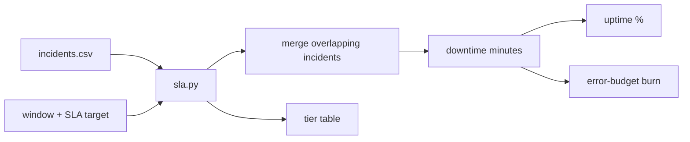

# SLA Uptime Calculator

Service-level agreements promise a percentage of uptime, which translates into a small amount of allowed downtime. This tool computes uptime for a period from an incident log, shows allowed downtime for common SLA tiers, and reports how much of the error budget has burned.

> Portfolio project. Uses simulated/sample data only.

## Architecture



## Setup

```bash
git clone https://github.com/AJJudkins/sla-uptime-calculator.git
cd sla-uptime-calculator
# Python 3.9+, standard library only
```

## Usage

```bash
python sla.py sample_data/incidents.csv --start 2026-01-01 --end 2026-01-31
python sla.py sample_data/incidents.csv --start 2026-01-01 --end 2026-01-31 --sla 99.5
```

## Sample output

```text
Window: 2026-01-01 to 2026-01-31 (43200.0 min)
Downtime: 65.0 min | Uptime: 99.8495%
SLA target 99.9% -> error budget 43.2 min, burned 150.5%
SLA BREACHED

Allowed downtime per tier for this window:
  99%        432.0 min
  99.5%      216.0 min
  99.9%       43.2 min
  99.95%      21.6 min
  99.99%       4.3 min
```

## Tests

```bash
pip install -r requirements-dev.txt
pytest
```

## What this demonstrates

- SRE concepts: SLAs, error budgets and burn rate
- Correct interval handling: overlapping incidents are merged and incidents are clipped to the window
- Simple CSV input and a CLI with tested pure functions

## Limitations

- Incident data is made up. Timestamps are naive (no time zones).
- Treats every incident as full downtime; no partial degradation or weighting.
- One window at a time, with no rolling windows or burn-rate alerting.
- Sample data uses a 99.9% target over 30 days, which is deliberately breached to show the output.

## License

MIT
